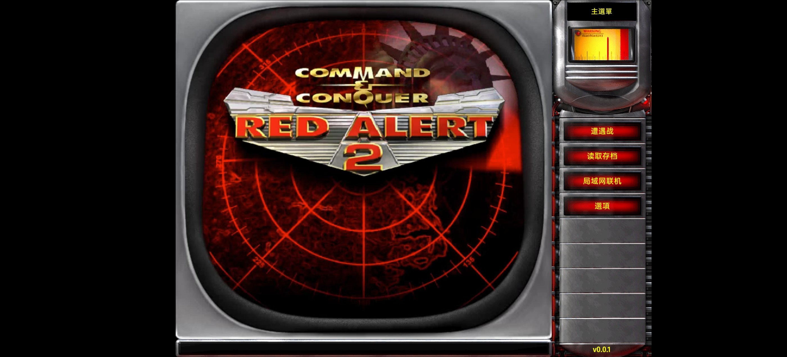
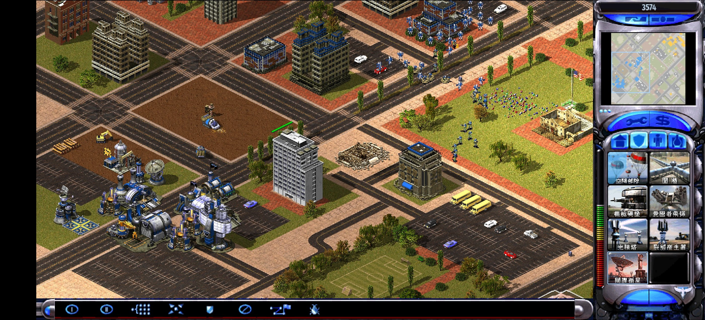

# 红警2 共和国之辉 · Android 轻量版

> **Skirmish-only / 仅遭遇战**  
> 一个把《红色警戒2》+《共和国之辉》MOD 的数据，用 TypeScript/WebGL 重写引擎跑在 Android WebView 里的轻量移植项目。

---

## 项目状态

- **已归档 / 停止开发**
- 稳定版只保留：**遭遇战（Skirmish）**
- 原版战役、战役影片、背景音乐均不包含
- 源码公开，**禁止商业使用**
- 仅在作者自己的手机上做过完整真机验证

---

## 为什么仓库不公开完整游戏包 / APK

先把最重要的话放在开头：

> **本仓库只公开代码、构建脚本和说明文档，不公开包含原版游戏素材的完整 APK。**

原因有三个：

1. **版权**
   - `ra2.mix`、`language.mix`、`general.csf`、地图、SHP/VXL 等素材版权归 **EA / Westwood** 所有；
   - 《共和国之辉》MOD 的素材版权归 MOD 原作者；
   - 我没有权利把这些素材以“开源”的名义重新分发。

2. **仓库体积**
   - 完整 APK 约 **450 MB**，其中绝大部分是原版素材；
   - 不适合直接塞进 Git 仓库，也不适合让每个 clone 都下载一遍；
   - `.gitignore` 已经排除了 APK、MIX、地图、CSF 等文件。

3. **安全与责任**
   - 不想让“带完整素材的 APK”被二次打包、挂广告、拿去售卖；
   - 也不想因为素材传播问题给使用者和上游项目带来麻烦。

所以仓库提供的是：

- ✅ 重写引擎的 TypeScript 源码
- ✅ Android WebView 壳、本地 HTTP 服务、构建脚本
- ✅ 汉化层、兼容性修复、开发文档
- ✅ 如何从**你自己合法拥有的游戏**中提取资源的说明

你需要自己拥有《红色警戒2》和《共和国之辉》，然后按文档构建自己的个人 APK。

---

## 这是什么

这不是 Wine、Box64、Winlator 之类的 Windows 容器，也不是把原版 `game.exe` 直接跑在 Android 上。

它的做法是：

1. 从你合法拥有的《红警2》+《共和国之辉》安装包中提取原版数据：
   - `ra2.mix`、`language.mix`、`multi.mix`、`sidec01/02.mix` 等
   - `rules.ini`、`art.ini`
   - `general.csf` 中文文本
   - 地图、SHP、VXL、调色板
2. 用一套 **TypeScript + WebGL 的重写引擎**读取这些数据；
3. 用 Android WebView 运行这套 Web 引擎；
4. 用本地 HTTP 服务和 OPFS 解决 WebView 的资源加载/持久化问题。

所以它是一个：

> **复用原版游戏数据、重写游戏引擎的轻量级移植版**，不是原版 EXE 的模拟器。

---

## 开发初衷

小时候在电脑上玩《红色警戒2》和《共和国之辉》，现在手机性能早就够了，但想在手机上随时开一局遭遇战，却只能找到：

- 云游戏（要网络、要会员、延迟高）
- Winlator/Box64（重、烫、操作别扭）
- 各种整合包（体积大、兼容性玄学）

于是就有了这个项目：

> **在手机上方便地回味童年，能随时打一局遭遇战就够了。**

没有打算做完整 remaster，也没有打算还原原版战役。它就是一个“能装在手机上、点开就能玩遭遇战”的轻量版本。

---

## 功能

| 功能 | 状态 |
|---|---|
| Android 安装运行 | ✅ |
| 中文界面 | ✅ |
| 遭遇战 | ✅ |
| 地图选择 | ✅ |
| 敌人/国家/颜色/难度 | ✅ |
| 中国 MOD 单位/建筑 | ✅ |
| 建造菜单/放置建筑 | ✅ |
| 触摸操作 | ✅ |
| 采矿/战斗/基础 AI | ✅ |
| 读取存档入口 | ✅（未充分验证） |
| 局域网联机入口 | ✅（未充分验证） |
| 原版战役 | ❌ |
| 战役影片 | ❌（数据源只有 5 字节占位） |
| 背景音乐 | ❌（`theme.mix` 是零占位） |
| 完整后期平衡/全部地图 | ⚠️ 未逐项验证 |

---

## 最终效果

以下截图都是作者手机上实际运行的画面，不是渲染图。

### 主菜单



- 完整中文主菜单；
- 只剩遭遇战、读取存档、局域网联机、选项；
- 没有战役按钮；
- 主菜单影片是转码后的 WebM。

### 遭遇战



- 手机横屏全屏；
- 中文 HUD/建造菜单；
- 中国 MOD 单位与建筑；
- 触摸选中、部署 MCV、建造、采矿、战斗；
- 画面来自 1272×2800 手机屏幕的实际截屏。

### 它不是什么“模拟器画面”

游戏逻辑运行在 WebView 里的 TypeScript 引擎中，通过 WebGL 绘制；不是 Wine/Box64 窗口，也不是远程云游戏。

---

## 不包含什么

这个项目**不是**：

- 原版《红色警戒2》的完整复刻；
- 原版战役模拟器；
- Wine/Box64/Winlator 容器；
- 包含原版游戏素材的官方发行版；
- 可以商用的产品。

它**只有遭遇战**。战役模式曾经做过实验，但因为缺少完整的 Team/Script 运行时、战役触发器覆盖不足、真机黑屏/性能问题，已经放弃。

---

## 使用方式

### 方式一：自己构建 APK（推荐，也是仓库唯一公开方式）

仓库只包含**代码**，不包含原版游戏资源，也不发布带素材的 APK。

你需要自己拥有：

- 《红色警戒2》原版；
- 《共和国之辉》MOD；
- 对应的安装包/解包目录。

准备资源后，按下方“从源码构建”的步骤生成：

```text
android/ra2ghg.apk
```

这是最推荐的方式：素材来自你自己的游戏，风险最低，也符合本项目的非商业许可。

### 方式二：如果你拿到了别人构建的个人测试 APK

> 注意：原版游戏素材版权归 EA/Westwood 所有。  
> **不要公开分发包含 `ra2.mix`、`language.mix` 等原版素材的 APK。**  
> 个人测试 APK 只建议用于自己拥有的游戏。

1. 准备 Android 手机：
   - Android 8.0+（minSdk 26）
   - arm64-v8a
   - 建议 4 GB 以上内存
   - 至少 2 GB 可用空间
   - 较新的 Android System WebView（Chromium 内核）
2. 安装 APK：
   - 允许“安装未知来源应用”；
   - 不需要 root。
3. 首次启动：
   - 应用会把约 **444 MB** 的游戏资源写入 WebView 的 OPFS；
   - 第一次启动/更新后第一次启动会比较慢，请保持前台、亮屏；
   - 后续启动会复用同一份数据。
4. 进入主菜单：
   - **遭遇战**
   - **读取存档**
   - **局域网联机**
   - **選項**
5. 遭遇战：
   - 选中国；
   - 选地图、敌人、颜色、难度；
   - 开始游戏；
   - 触摸选中 MCV，部署建造场，然后正常建造。

---

## 环境要求与兼容性

### 作者真机验证环境

- 手机：一加 Ace 5 至尊版（`PLC110`）
- 系统：Android 16 / API 36
- CPU：arm64-v8a，MediaTek MT6991
- 屏幕：1272×2800，560 dpi
- WebView：154
- 运行内存：足够（建议 12 GB 或以上）
- 存储：约 50 GB 可用

### 兼容性说明

> **这个 App 大概率只在和作者手机环境配置相似的机器上才能完美运行。**

原因：

- 它依赖 Android System WebView 的 WebGL/Worker/OPFS 行为；
- 不同厂商的 WebView 版本、GPU 驱动、屏幕比例、触摸映射都可能不同；
- 固定 8787 端口、OPFS 首次 seeding、HUD 缩放都对环境敏感；
- 作者没有在多机型上做系统测试。

在其他手机上可能出现：

- 首帧黑屏/花屏；
- WebGL 上下文创建失败；
- 触摸位置偏移；
- 字体/UI 过大或过小；
- 帧率低、发热、内存不足；
- 首次 seeding 卡住。

**能启动不代表能完美运行；请以你自己的真机测试为准。**

---

## 已知问题 / Bug 列表

项目已归档，以下问题不承诺修复：

1. **首次启动很慢**
   - 需要把约 444 MB 资源写入 OPFS；
   - 看起来像卡在“加载中”，请耐心等待。

2. **更新 APK 后第一次启动也可能很慢**
   - 新增资源需要补写 OPFS；
   - 不要在这个时候清数据，否则会重新 seed。

3. **只支持遭遇战**
   - 没有原版战役；
   - 没有战役影片；
   - 没有背景音乐。

4. **机型/WebView 兼容性**
   - 只在作者手机上完整验证；
   - 其他机型可能黑屏、掉帧、触摸错位或直接无法进入游戏。

5. **地图/科技兼容**
   - 部分地图可能引用不支持的科技类型；
   - 部分 MOD 单位/建筑在后期可能表现异常；
   - 没有逐张地图、逐个单位做完整回归。

6. **LAN 入口未充分验证**
   - 主菜单保留“局域网联机”；
   - 没有做多机联调，不保证可用。

7. **读取存档未充分验证**
   - 入口存在，但没有做完整存档/读档回归。

8. **触摸操作**
   - 稳定版在作者手机上触摸正常；
   - 不同屏幕比例/WebView 版本可能出现点不中、HUD 偏移。

9. **固定端口 8787**
   - 不能随便改端口；
   - 改了会换 origin，OPFS 里的资源全部失效，需要重新 seed。

10. **旧进程残留**
    - 更新/回滚后如果直接进旧游戏，不一定是 APK 逻辑；
    - 先 `adb shell am force-stop com.dsh.ra2ghg`，确认进程退出再启动。

11. **地图名/版本号/ID 仍是英文**
    - UI 已汉化；
    - 地图名属于内容/专有名词；
    - 版本号和 LAN 身份 ID 保留英文/十六进制。

12. **APK 体积大**
    - 约 450 MB；
    - 因为包含原版 MIX 资源；
    - 不适合低存储设备。

13. **源码里的战役代码是休眠的**
    - `src/game/campaign/*` 仍然存在；
    - 稳定版通过编译开关和地图过滤关闭；
    - 不要在稳定版里重新启用。

---

## 技术原理（简述）

```text
APK
├─ assets/web/       React + TypeScript 引擎
└─ assets/gameres/   原版 MIX/INI/CSF/SHP/VXL
        │
        ▼
Android WebView（Chromium/V8）
├─ TypeScript 游戏逻辑
├─ WebGL / Three.js 渲染
├─ Web Worker / WASM 解码
└─ OPFS 资源缓存
        ▲
        │ fetch
AssetServer（纯 Java，本地 HTTP）
http://127.0.0.1:8787
```

关键点：

- **不是 x86 模拟器**：不执行原版 `game.exe`；
- **不是 Wine/Box64**：没有 Windows 兼容层；
- **WebView 是运行时**：V8 JIT 把 JS 编译成 ARM 机器码；
- **本地 HTTP 服务**：解决 `file://` 的 origin、OPFS、SharedArrayBuffer、CORS 问题；
- **固定端口 8787**：保证 OPFS origin 稳定；
- **OPFS seeding**：首次启动把 APK 内资源复制到 WebView 私有文件系统；
- **资源解析**：MIX 归档、INI 规则、CSF 文本、SHP 精灵、VXL 体素、地图 INI。

更详细的移植/构建/调试说明见仓库的 `docs/` 或交接文档。

---

## 从源码构建

### 依赖

- Windows（当前构建脚本是 PowerShell）
- JDK 17
- Android SDK：
  - build-tools（含 aapt2、d8、zipalign、apksigner）
  - platform android-36
- Bun（构建 Web）
- Python 3
- 7-Zip（解包原版安装包）

### 1. 准备游戏资源

从你合法拥有的安装包中提取：

```text
ra2.mix
language.mix
multi.mix
theme.mix
expand01.mix
ecache01.mix
maps01.mix
maps02.mix
sidec01.mix
sidec02.mix
general.csf
rules.ini
ra2ts_l.webm（可选，主菜单影片）
manifest.json
```

放到：

```text
android/assets/gameres/
```

另外把同一份 `general.csf` 复制到：

```text
redalert2/public/general.csf
```

因为 Vite 构建时会把它复制到 `dist/general.csf`；仓库出于版权原因没有提交这个文件。

注意：

- 稳定版不要放 `.MAP` 战役地图；
- `android/assets/gameres` 应该是 14 个文件、0 个 `.MAP`；
- 不要把开发目录 `gameres-export/` 整体复制进去。

### 2. 构建 Web

```powershell
$bun = 'path\to\bun.exe'
Set-Location redalert2
$env:RA2_CAMPAIGN = $null
& $bun run build
```

把 `dist/` 同步到：

```text
android/assets/web/
```

### 3. 构建 APK

```powershell
$env:ANDROID_SDK_ROOT = 'C:\path\to\android-sdk'
$env:JAVA_HOME = 'C:\path\to\jdk17'
$env:RA2_KEYSTORE_PASS = 'set-a-password'  # 可省略，默认 ra2ghg-local-dev
Set-ExecutionPolicy -Scope Process -ExecutionPolicy Bypass -Force
& .\android\build.ps1
```

输出：

```text
android/ra2ghg.apk
```

### 4. 安装

```powershell
adb install -r android\ra2ghg.apk
adb shell am start -n com.dsh.ra2ghg/.MainActivity
```

### 构建注意事项

- **不要用 `aapt2 -A assets`**：Windows 会写反斜杠路径，手机端会 404。
- `pack_assets.py` 会用 Python `zipfile` 以 `/` 路径打包。
- `.mix` 以 `ZIP_STORED` 存放，避免每次读取都解压。
- 不要改端口 8787。
- 不要删除签名 keystore，否则无法覆盖安装。
- `build.ps1` 使用 `$PSScriptRoot`，通过 `ANDROID_SDK_ROOT` / `JAVA_HOME` 找工具链；不再依赖作者机器路径。
- `RA2_KEYSTORE_PASS` 只用于本地自签名；正式分发请用自己的 keystore。

---

## 目录结构（参考）

```text
.
├─ redalert2/                    # TypeScript/Web 引擎与 UI
│  ├─ src/
│  ├─ public/
│  ├─ dist/                      # 构建产物
│  └─ vite.config.ts
├─ android/
│  ├─ src/com/dsh/ra2ghg/        # MainActivity / AssetServer
│  ├─ assets/web/                # Web 构建产物
│  ├─ assets/gameres/            # 稳定版资源
│  ├─ build.ps1
│  ├─ pack_assets.py
│  └─ AndroidManifest.xml
├─ docs/
├─ tools/
└─ README.md
```

如果你的仓库结构不同，以实际路径为准。

---

## 汉化说明

- 单位、建筑、任务文本来自官方中文 CSF；
- 主菜单/设置/LAN 等硬编码英文由 `src/gui/i18n/zhUi.ts` 做 DOM 翻译；
- 默认玩家名“指挥官”；
- 保留英文：地图名、版本号、LAN 身份 ID、调试日志。

---

## 为什么没有战役

战役数据其实存在：

- `mission.ini` 101 个 section；
- 24 张主战役 + 2 张教学；
- 1893 个触发器、1181 个 TeamTypes、1002 个 ScriptTypes、910 个 TaskForces。

但现有重写引擎缺少：

- 完整 Team/Script 运行时；
- 战役专用 trigger action/event；
- AI 生产/AI triggers；
- 任务目标、EVA、下一关、进度存档；
- 大量地图特有的脚本逻辑。

做过 PoC（能加载 TRN01/ALL01、显示简报、刷队、胜负、下一关），但离“24 关可通关”差很远，且真机有黑屏/性能问题，所以放弃。

---

## 贡献

项目已归档，但仍欢迎：

- Bug 报告；
- 兼容性测试；
- 代码整理/文档改进；
- 不包含原版素材的 PR。

提 Issue 时请附：

- 手机型号、Android 版本；
- WebView 版本；
- 是否首次启动；
- `adb logcat` 相关日志；
- 截图/录屏。

**不要**在 PR/Issue 里上传：

- `ra2.mix`、`language.mix` 等原版资源；
- 含原版资源的 APK；
- 任何商业素材。

---

## 版权、许可与免责声明

### 代码许可

本项目**原创代码**采用：

> **PolyForm Noncommercial License 1.0.0**

- 允许个人、非商业使用、修改、分发；
- **禁止任何商业用途**，包括但不限于：
  - 售卖 APK/源码；
  - 付费下载/会员制；
  - 广告变现；
  - 商业托管/云游戏服务；
  - 捆绑销售；
  - 以本项目为基础提供商业服务。
- 严格来说，这是 **source-available（源码公开）**，不是 OSI 定义的开源许可证。

### 上游代码

本项目并非从零重写全部引擎：Web 引擎来自 Chrono Divide / RA2Web 系代码。

- PolyForm 非商业条款仅适用于本项目作者新增的 Android 壳、适配层、汉化、构建脚本等原创部分；
- 上游引擎/库代码仍遵循其原有许可证；
- 如果上游许可证与本项目的非商业条款存在冲突，以上游许可证为准；
- 无论上游许可证如何，**不得将整个组合作商业使用**；
- 发布/再分发前请自行核对上游 LICENSE 和版权声明。

### 文档许可

README、文档、截图等采用：

> **CC BY-NC-SA 4.0**

### 原版游戏素材

- 《红色警戒2》《尤里的复仇》及相关素材版权归 **Electronic Arts / Westwood Studios** 所有；
- 《共和国之辉》MOD 版权归其原作者所有；
- 本项目**不包含、不授权、不分发**原版游戏素材；
- 你需要自己合法拥有原版游戏，并自行提取资源；
- 不要把原版素材或含素材的 APK 上传到 GitHub。

### 上游引擎

本项目基于 Chrono Divide / RA2Web 系的重写引擎进行二次开发。  
上游代码/素材遵循其原有许可证；发布/再分发前请自行核对上游 LICENSE 和版权声明。

### 免责声明

本项目按 **“现状（AS IS）”** 提供，不提供任何明示或暗示的担保，包括但不限于：

- 可用性；
- 无错误；
- 不侵犯第三方权利；
- 适用于特定用途。

使用本项目造成的任何后果，包括但不限于：

- 设备发热、耗电、卡顿、崩溃；
- 数据丢失；
- 存档损坏；
- 账号/设备风险；
- 法律风险；
- 因使用原版素材产生的版权纠纷；

由使用者自行承担。作者不承担任何直接或间接责任。

**本项目与 Electronic Arts、Westwood Studios 没有任何关联，也未获得其授权或背书。**

以上内容不构成法律建议；如涉及商业使用/再分发，请咨询专业律师。

---

## Credits

- **Westwood Studios / Electronic Arts**：原版《红色警戒2》
- **《共和国之辉》MOD 原作者**
- **Chrono Divide / RA2Web**：重写引擎与社区
- **Three.js、React、Vite、Bun、7z-wasm、FFmpeg、Playwright** 等开源项目
- 所有参与测试、反馈和提供思路的玩家

---

## English Summary

A lightweight, **skirmish-only** Android port of *Command & Conquer: Red Alert 2* + the *Glory of the Republic* mod.

It does **not** emulate the original x86 executable. Instead, it reuses the original game data (MIX/INI/CSF/SHP/VXL/maps) with a TypeScript/WebGL engine running inside an Android WebView, served through a loopback HTTP server and cached in OPFS.

- ✅ Chinese UI, skirmish, China mod units, touch controls
- ❌ No campaign, no music, no movies
- ❌ Not a Wine/Box64/Winlator container
- ⚠️ Tested only on the author's phone (OnePlus Ace 5 Ultimate, Android 16, WebView 154); other devices may have rendering/touch/performance issues
- 🚫 **Non-commercial use only** (PolyForm Noncommercial 1.0.0)
- ⚠️ No warranty; use at your own risk
- 🎮 Original game assets are copyrighted by EA/Westwood; this repository does not grant any rights to them

This is a fan project made for nostalgia: **just enough to play a skirmish on a phone**.
